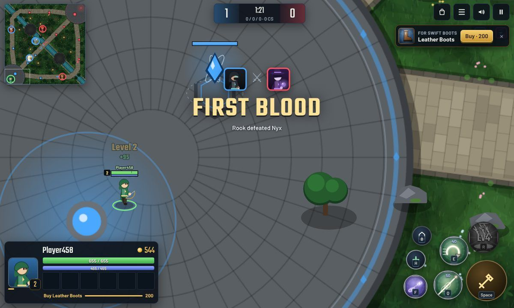
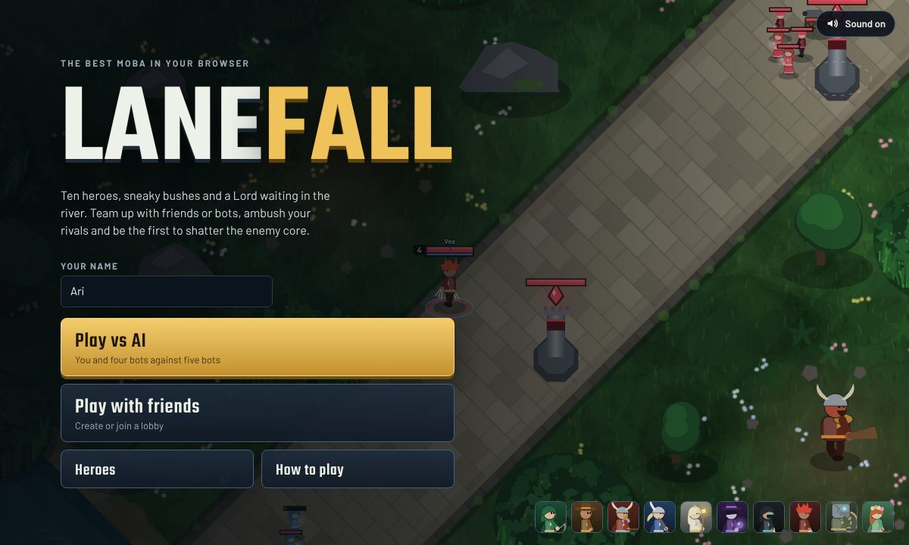
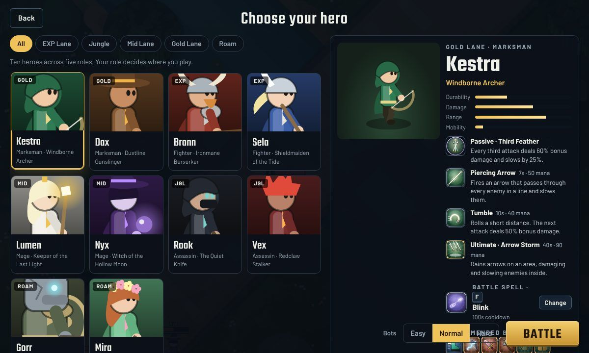
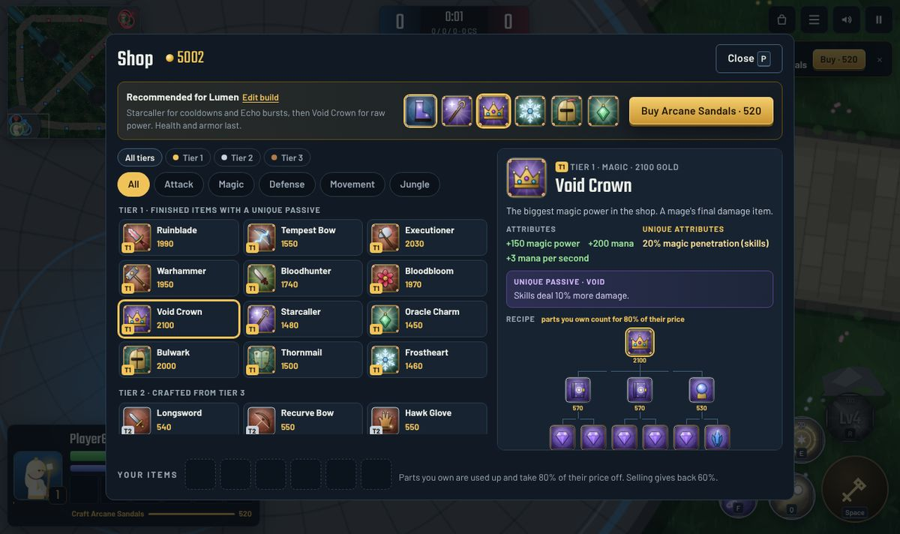
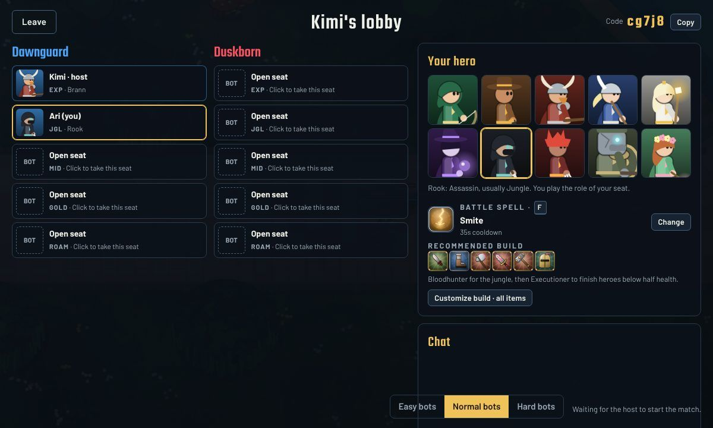
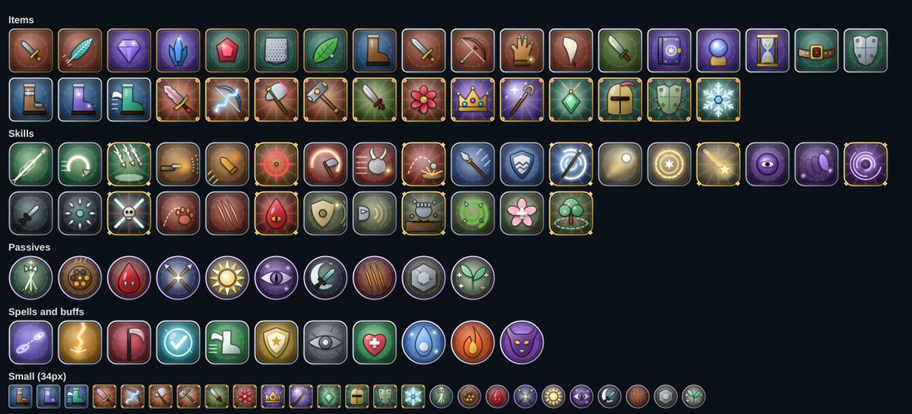

# Lanefall

**A 5v5, three-lane MOBA that runs in your browser.** Pick one of ten heroes across five roles, farm your lane, take the jungle, fight over the river bosses, craft your items, and break the enemy core. Play against bots or with friends in a lobby, on a computer or a phone.



**[Play on claude.ai](https://claude.ai/artifact/W5SQpmvpnDTZJgfx54qh65)** (invite-only) · **[Request access](https://claude.ai/artifact/V3HMr9bwRnFTQDzQ8YCSay)** · **[New player guide](https://claude.ai/artifact/14W4sJeNrLJBvvae57xiGU)** · [Run it yourself](#run-it-yourself)

No build step, no dependencies, no downloads: plain JavaScript and canvas.

---

## Contents

- [Highlights](#highlights)
- [Play](#play)
- [How a match works](#how-a-match-works)
- [Controls](#controls)
- [Heroes](#heroes)
- [Items and crafting](#items-and-crafting)
- [Regen, Recall and battle spells](#regen-recall-and-battle-spells)
- [Damage and defense](#damage-and-defense)
- [Multiplayer](#multiplayer)
- [Project structure](#project-structure)

## Highlights

- **10 heroes, 5 roles.** EXP, Jungle, Mid, Gold and Roam, each with a passive, two skills and an ultimate, all animated and drawn in code.
- **A full map.** Three paved lanes with two towers each, a jungle with buff camps and small camps, a river with the Tidewarden and the Lord, and bushes you can hide in.
- **Three-tier crafting.** 33 items: basic pieces craft into Tier 2 items, which craft into Tier 1 items with unique attributes and a unique passive.
- **Your own builds.** Plan a build for each hero from the full item list. A buy prompt walks you through it piece by piece, or you can prioritize any single item.
- **Battle spells and Regen.** Pick one of seven battle spells before each match. Every hero also has Regen and Recall.
- **Bots that play like a team.** Laners farm and trade, junglers clear and gank, mid laners roam, roamers protect. Teams get ready before bosses spawn, take them together, rush in to contest (and Smite-steal) when the enemy starts one, and push a tower with the Lord buff. Bots dodge skillshots, ranged heroes kite, and each bot is a little bolder or more careful than the next. Three difficulty levels.
- **Multiplayer lobbies.** Up to 10 players on claude.ai or your own server; empty seats are filled with bots.
- **Made for touch too.** Joystick, drag-to-aim skills and a compact layout for phones held sideways.

## Play

### On claude.ai

The game is published as a claude.ai page that only invited accounts can open.

1. Make a free account at [claude.ai](https://claude.ai) if you don't have one.
2. Send a request from the **[request page](https://claude.ai/artifact/V3HMr9bwRnFTQDzQ8YCSay)** with your claude.ai email.
3. Once you've been added, sign in with that email and open the **[game](https://claude.ai/artifact/W5SQpmvpnDTZJgfx54qh65)**.

The **[new player guide](https://claude.ai/artifact/14W4sJeNrLJBvvae57xiGU)** walks through every step with screenshots.

### Run it yourself

```sh
git clone <this repository>
cd moba
node server.js            # http://localhost:8080, single player and online multiplayer
```

Use `node server.js 3000` or `PORT=3000 node server.js` for another port. For single player only, any static file server works, for example `python3 -m http.server`.

`server.js` needs only Node.js (no packages). Run it on any Node host (Render, Railway, Fly.io, a VPS) and everyone who opens the address can play together, no accounts needed.



## How a match works

**Goal:** destroy the enemy **core**. To reach it, break the **outer** and **inner** tower in at least one lane. Towers guard each other: an inner tower can't be hurt while its outer tower stands, and the core can't be hurt until one inner tower has fallen. Structures also take 40% less damage for the first 3 minutes.

| Role | Plays | Suggested battle spell |
| --- | --- | --- |
| **EXP** | Top lane, alone. Durable fighters. | Reap |
| **Jungle** | Clears camps, ganks lanes, takes bosses. | Smite |
| **Mid** | Middle lane. Mages with burst and crowd control. | Blink |
| **Gold** | Bottom lane. Marksmen who scale into the main damage dealer. | Blink |
| **Roam** | Follows a lane to protect allies. Tanks and healers. | Aegis |

Your **seat** decides your role. Any hero can play any seat, but each hero is built for one role.

**Minions** march down all three lanes every 25 seconds (melee and caster minions, plus a siege minion every third wave). Landing the last hit on a minion or monster gives you its gold; staying nearby gives you experience.

**Economy and levels**

| | |
| --- | --- |
| Starting gold | 300, plus 3 gold per second |
| Hero kill | 250 gold, +40 per kill on the victim's streak (up to +200); assists get 90 |
| Tower or core | 120 gold for every hero on the team |
| Levels | 1 to 15; the ultimate unlocks at level 4 |
| Respawn | 5 seconds + 1.8 per level, up to 40 |

**Jungle and river**

| Monster | Where | Reward |
| --- | --- | --- |
| Azure Wisp | Each jungle | 120 gold, and 70 seconds of 20% shorter cooldowns plus faster mana regeneration |
| Ember Brute | Each jungle | 120 gold, and 70 seconds of attacks that slow and burn |
| Moss Beetle, Thorn Lizard, Shell Crab, Dusk Wolf | Each jungle | 65 to 70 gold |
| **Tidewarden** | River pit by the top lane, from 2:00 | 120 gold and experience for the whole team |
| **Lord** | Same pit, from 8:00 | 160 gold for the whole team, and 15% more damage for 90 seconds |

The two bosses share one pit. The Tidewarden holds it until 8:00; then it stops returning and the Lord takes over.

**Bushes** line the lanes and the jungle. A hero in a bush is invisible to enemies until an enemy steps into the same bush or the hidden hero deals damage. Area skills still hit.

## Controls

| Action | Keyboard and mouse | Touch |
| --- | --- | --- |
| Move | `W` `A` `S` `D` or arrows, or right-click the ground | Joystick (left side) |
| Basic attack | Hold `Space`, or click an enemy. A gold ring shows your range. | Attack button |
| Skills | Hold `Q` `E` `R` to aim at the cursor, release to cast | Drag a skill button to aim, tap to auto-aim |
| Battle spell | `F` (hold to aim Blink) | Spell button |
| Regen | `H` | Plus button |
| Recall | `B` | Home button |
| Shop | `P`, or **Buy** on the top-right prompt | Bag button |
| Scoreboard | Hold `Tab` | List button |
| Mute | `M` | Sound button |
| Pause or menu | `Esc` | Menu button |

**On the HUD:** active passives and buffs (with stacks and timers) sit at the bottom middle; hover or tap one to see what it does. Cooldowns keep counting down while you're dead.

## Heroes

| Hero | Role | Class | Passive | Skills (Q · E · ultimate R) |
| --- | --- | --- | --- | --- |
| **Brann** | EXP | Fighter | Bloodlust | Cleave · Charge · Warcry Leap |
| **Sela** | EXP | Fighter | Riposte | Spear Thrust · Shieldwall · Whirlwind |
| **Rook** | Jungle | Assassin | Ambush | Shadow Dash · Fan of Knives · Execute |
| **Vex** | Jungle | Assassin | Feral | Pounce · Rend · Bloodfrenzy |
| **Lumen** | Mid | Mage | Radiance | Arc Bolt · Radiant Field · Starfall |
| **Nyx** | Mid | Mage | Hex | Hex Orb · Shade Step · Void Rift |
| **Kestra** | Gold | Marksman | Third Feather | Piercing Arrow · Tumble · Arrow Storm |
| **Dax** | Gold | Marksman | Hot Barrels | Scatter Shot · Overdrive · Deadeye |
| **Gorr** | Roam | Tank | Granite Skin | Shield Bash · Rallying Roar · Earthquake |
| **Mira** | Roam | Support | Verdant | Thorn Snare · Bloom · Sanctuary |

The hero select screen shows each hero's stats, every skill's cooldown, mana cost and effect, their battle spell and their build.



## Items and crafting

Press `P` to open the shop anywhere on the map. Items come in three tiers:

- **Tier 3** (150 to 200 gold): basic pieces with one or two attributes.
- **Tier 2** (300 to 570 gold): crafted from 1 or 2 Tier 3 pieces. Some add a **unique attribute** such as critical chance or lifesteal.
- **Tier 1** (1,450 to 2,100 gold): crafted from 2 or 3 Tier 2 items. Each has attributes, unique attributes and a **unique passive**.

**How crafting works**

- Buying an item uses up the parts you own, and each part takes **80%** of its own price off. Buying piece by piece costs a little more than saving up, but gives you stats sooner.
- A Tier 3 piece crafted into a Tier 2 item is gone; from then on only the Tier 2 item counts toward the Tier 1 price.
- Many parts feed several Tier 1 items (a Longsword goes into five), but every craft consumes its parts.
- Unique attributes and passives count once, even if you own two copies.
- Six slots, one pair of boots. Selling refunds 60% of the full price.

**Buying.** Nothing is bought without your click. When you can afford the next piece of your build, a **buy prompt** appears in the top-right corner. Press **Prioritize** on any item in the shop to have the prompt lead you to that item first. **Customize build** (hero select, lobby or shop) lets you plan your own six items per hero; it's saved in your browser.



**Tier 1 items**

| Item | Cost | Recipe | Attributes | Unique passive |
| --- | ---: | --- | --- | --- |
| Ruinblade | 1990 | Longsword + Vampire Fang + Recurve Bow | +60 attack, +20% attack speed, +3 health per second, **10% lifesteal** | **Ruin:** attacks deal bonus damage equal to 5% of the target's current health (up to 80 against monsters) |
| Tempest Bow | 1550 | Recurve Bow + Hawk Glove | +30 attack, +35% attack speed, **25% critical chance** | **Chain Lightning:** every 3rd attack hits 2 more nearby enemies for 60 + 30% attack |
| Executioner | 2030 | Longsword + Longsword + Hawk Glove | +75 attack, +10% attack speed, **20% armor penetration, 15% critical chance** | **Despair:** 20% more damage to heroes below half health |
| Warhammer | 1950 | Longsword + Giant's Belt + Hourglass | +40 attack, +450 health, +120 mana, +3 health per second, 15% cooldown reduction | **Fury:** each skill grants 10% attack for 4 seconds, stacking 3 times |
| Bloodhunter | 1740 | Hunter Machete + Longsword + Vampire Fang | +55 attack, +3 health per second, **+60% damage to monsters, 10% lifesteal** | **Hunt:** killing a monster restores 12% health and mana |
| Bloodbloom | 1970 | Giant's Belt + Vampire Fang + Longsword | +45 attack, +450 health, +3 health per second, **10% lifesteal** | **Rampage:** skills that hit a hero heal you for 3% of max health |
| Void Crown | 2100 | Sage Tome + Sage Tome + Focus Orb | +150 magic power, +200 mana, +3 mana per second, **20% magic penetration** | **Void:** skills deal 10% more damage |
| Starcaller | 1480 | Focus Orb + Hourglass | +75 magic power, +350 mana, +3 mana per second, 20% cooldown reduction, **10% spell vamp** | **Echo:** every 8 seconds, your next skill hit deals 80 + 30% magic power extra |
| Oracle Charm | 1450 | Hourglass + Giant's Belt | +500 health, +6 health per second, +120 mana, 15% cooldown reduction, **heals 25% stronger** | **Blessing:** allies you heal or shield get 20% move speed for 2 seconds |
| Bulwark | 2000 | Scale Plate + Giant's Belt + Giant's Belt | +1100 health, +25 armor, **25% shorter crowd control** | **Fortify:** below 40% health, gain a shield of 25% max health (30 second cooldown) |
| Thornmail | 1500 | Scale Plate + Scale Plate | +55 armor, +350 health | **Thorns:** heroes that attack you take 15% back as true damage |
| Frostheart | 1460 | Scale Plate + Hourglass | +35 armor, +200 health, +250 mana, +3 health per second, 15% cooldown reduction | **Frostbite:** heroes that attack you are slowed 20% for 1 second |

<details>
<summary><strong>Tier 2 and Tier 3 items</strong></summary>

| Tier 2 item | Cost | Recipe | Attributes |
| --- | ---: | --- | --- |
| Longsword | 540 | Iron Dagger + Iron Dagger | +28 attack |
| Recurve Bow | 550 | Swift Feather + Iron Dagger | +12 attack, +18% attack speed |
| Hawk Glove | 550 | Swift Feather + Iron Dagger | +10 attack, +10% attack speed, **15% critical chance** |
| Vampire Fang | 500 | Iron Dagger + Healing Leaf | +14 attack, +3 health per second, **8% lifesteal** |
| Hunter Machete | 300 | Iron Dagger | +14 attack, **+40% damage to monsters** |
| Sage Tome | 570 | Arcane Gem + Arcane Gem | +50 magic power, **8% magic penetration** |
| Focus Orb | 530 | Arcane Gem + Mana Shard | +35 magic power, +180 mana, +2 mana per second |
| Hourglass | 500 | Mana Shard + Healing Leaf | +120 mana, +3 health per second, 10% cooldown reduction |
| Giant's Belt | 530 | Vital Ruby + Vital Ruby | +380 health |
| Scale Plate | 540 | Chain Vest + Vital Ruby | +20 armor, +180 health |
| Warrior Boots | 550 | Leather Boots + Chain Vest | +30 move speed, +12 armor, **20% shorter crowd control** |
| Arcane Sandals | 520 | Leather Boots + Mana Shard | +30 move speed, 10% cooldown reduction |
| Swift Boots | 550 | Leather Boots + Swift Feather | +30 move speed, +15% attack speed |

| Tier 3 item | Cost | Attributes |
| --- | ---: | --- |
| Iron Dagger | 180 | +10 attack |
| Swift Feather | 200 | +10% attack speed |
| Arcane Gem | 200 | +20 magic power |
| Mana Shard | 150 | +120 mana, +2 mana per second |
| Vital Ruby | 180 | +150 health |
| Chain Vest | 180 | +10 armor |
| Healing Leaf | 150 | +3 health per second |
| Leather Boots | 200 | +15 move speed |

Unique attributes are in bold.

</details>

## Regen, Recall and battle spells

Every hero has:

- **Regen** (`H`): restores 35% of your health over 5 seconds, even while walking. Attacking, casting, or taking damage from heroes or towers stops it. 25 second cooldown.
- **Recall** (`B`): teleports you to your base after 3.5 seconds. Moving or taking damage cancels it.

Before each match, pick one **battle spell** (`F`) per hero on the hero select screen or in the lobby:

| Spell | Cooldown | Effect |
| --- | ---: | --- |
| Blink | 100s | Teleport a short distance in any direction |
| Smite | 35s | 450 + 40 per level true damage to the nearest monster or minion |
| Reap | 90s | 120 + 12 per level + 15% of missing health as true damage to a nearby enemy hero |
| Cleanse | 90s | Break stuns, roots and slows (works while stunned), then 1.2 seconds of immunity and 20% speed |
| Sprint | 90s | 45% move speed for 5 seconds |
| Aegis | 90s | A shield of 300 + 40 per level on you and the most hurt ally nearby |
| Stonegaze | 90s | Stun enemies around you for 0.8 seconds and deal 80 + 12 per level damage |

## Damage and defense

| Damage | Comes from | Reduced by |
| --- | --- | --- |
| **Attack** | Basic attacks | Armor, lowered by armor penetration |
| **Skill** | Skills and ultimates | Armor, lowered by magic penetration |
| **True** | Smite, Reap, Thornmail, the Ember buff's burn | Nothing |

Armor works the same against everything: you take `100 / (100 + armor)` of a hit, so 100 armor halves damage. Shields absorb damage before health. Tenacity shortens stuns, roots and slows. Critical hits deal 175%. Lifesteal heals from attacks and skills, spell vamp from skills.

## Multiplayer

One player **hosts** a lobby and shares its 5-letter code; up to nine others join with the code, pick a seat, a hero and a battle spell, and the host starts the match. Empty seats are filled with bots at the host's chosen difficulty.

The host's browser runs the whole match. It streams compact snapshots to everyone about 12 times a second, and the other players send only their inputs. If a player drops out, a bot takes over their hero.

Three transports share the same code (`src/net.js`) and are picked automatically:

- **claude.ai:** when the page is published as an Artifact with the `room` capability, everyone the page is shared with can see and join lobbies.
- **`server.js`:** a small WebSocket relay; everyone connected to the server sees the lobby list.
- **Same device:** with neither, lobbies work between browser tabs (BroadcastChannel), which is handy for testing.



## Project structure

```
index.html        screens, HUD and overlays
style.css         all styling, including the touch layout
server.js         static file server + WebSocket relay (Node.js, no packages)
src/
  data.js         map geometry, heroes, items, spells, monsters, tuning
  sim.js          the authoritative simulation: combat, skills, items, minions, towers, jungle, rewards
  ai.js           role-based bot brains
  art.js          procedural animated characters, monsters and terrain
  icons.js        procedural icons for items, skills, passives, spells and buffs
  render.js       camera, world drawing, effects, minimap
  net.js          transports, lobbies, snapshot encoding and decoding
  input.js        keyboard, mouse and touch controls
  ui.js           screens, HUD, shop, build editor
  main.js         game loop and mode switching (bots, host, client)
docs/screenshots  images used in this README
```

The files are plain scripts loaded in order and share one global, `window.LF`. The simulation runs at a fixed 30 steps per second and doesn't touch the DOM, so it also runs headless in Node.js, which is useful for balance tests and bot-only matches.

Every picture in the game, from heroes and monsters to the map and icons, is drawn in code at runtime; there are no image files.



**Console tools:** in the browser console, `lanefall.game` is the live simulation and `lanefall.fast(seconds)` fast-forwards it.

---

Built with [Claude Code](https://claude.ai/code).
